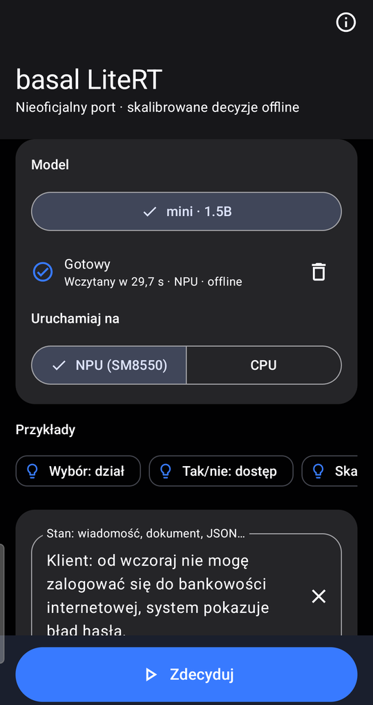
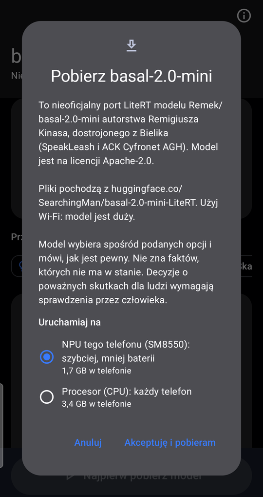
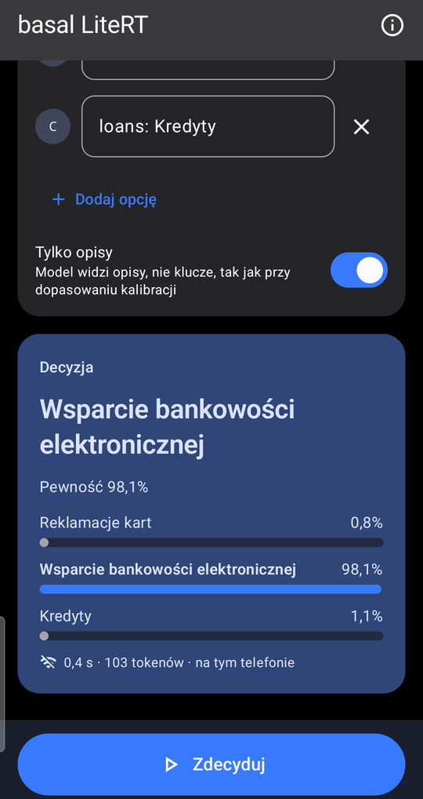
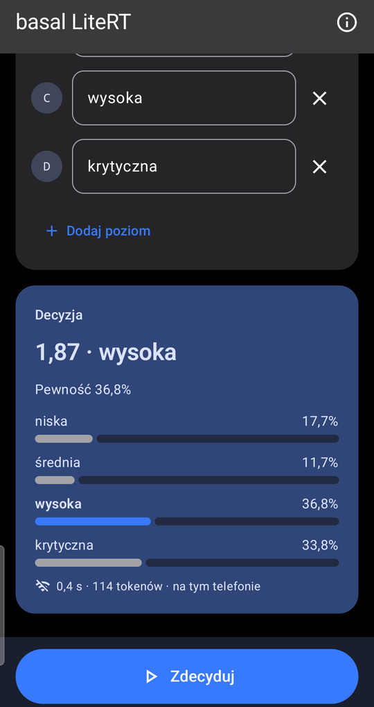
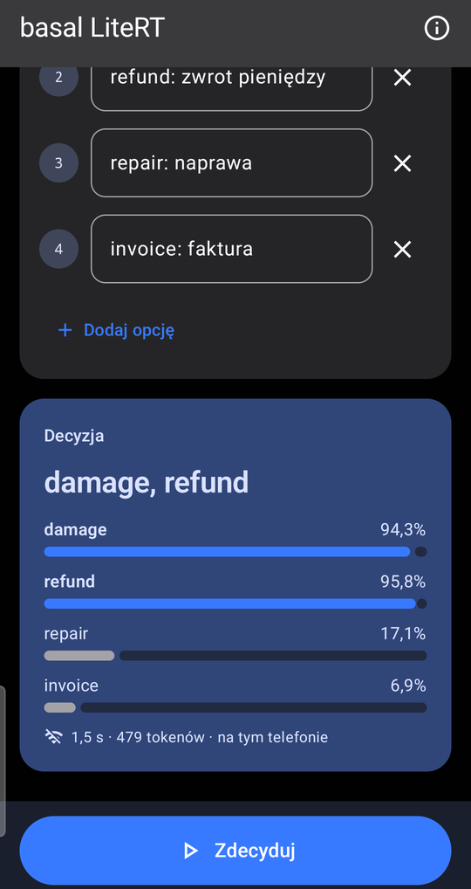

# basal-android

An unofficial Android app and LiteRT conversion for the [basal-2.0](https://github.com/rkinas/basal) typed-decision
models by Remigiusz Kinas: ask a question about a text, give the allowed answers, and get a calibrated probability for
each one, on the phone and offline.

- **Model on Hugging Face:** [SearchingMan/basal-2.0-mini-LiteRT](https://huggingface.co/SearchingMan/basal-2.0-mini-LiteRT)
  (1.5B), with its port check and phone timings.
- **App:** the APK is attached to each [release](https://github.com/kgonia/basal-android/releases). It downloads the
  model (Wi-Fi recommended) and runs it with Google LiteRT: on the NPU of a Snapdragon 8 Gen 2 or 8 Gen 3 (e.g. the
  Galaxy S23 series and the S24 Ultra), or on the CPU of any arm64 phone.

Not affiliated with or endorsed by the basal or Bielik authors. The models are theirs (Apache-2.0); this repository
only runs them.

<p>





</p>

On a Galaxy S23 Ultra, NPU, in the app's Polish UI: the model ready (the first load, 29.7 s, includes the NPU self-test; later loads take about 3 s), the download dialog, and the answers to three of the built-in examples (0.4 s for about 100 tokens).

## Results

basal-2.0-mini on a Galaxy S23 Ultra and S24 Ultra, against the source model in bf16, with the bars the basal author publishes for
ports (agreement on questions with 2–10 options ≥ 0.916, accuracy diff ≥ −0.01):

| variant | agreement (2–10 options) | accuracy diff | median per question |
|---|---|---|---|
| CPU, dynamic int8 | 0.961 | +0.003 | 1.06 s |
| NPU (SM8550), W8A16 | 0.992 | −0.003 | 0.88 s |
| NPU (SM8650, S24 Ultra), W8A16 | 0.992 | −0.003 | 1.16 s |

The full check is on the model card.

## How it works

basal answers a question in one forward pass, without generating text: the prompt (prompt format 2, see the engine's
[FORMAT2.md](https://github.com/rkinas/basal/blob/v2.0.0/docs/FORMAT2.md)) ends with `{"answer": "`, and the softmax
over the next-token logits of the option codes (`A`, `B`, …) is the decision, then a temperature from the model's
`CALIBRATION.json`.

So there is no sampling, and nothing is kept between questions. Both variants return the logits of the 255 code
tokens only.

- **CPU:** the Llama prefill in one file, with a signature per prompt length `p128` … `p2048` sharing the weights:
  `tokens` (int32 `[1, L]`, right-padded) and `last` (the position to read) in, `logits` (float32 `[1, 255]`) out.
  Attention is causal, so the padding after `last` cannot change the result.
- **NPU:** W8A16 (int8 weights, int16 activations), compiled ahead of time for one Qualcomm chip, in 4 parts of
  7–9 layers. The prompt runs in chunks of 128 tokens against a key-value cache. The fixed start of the prompt has its
  keys and values precomputed per language, and the app computes the final norm and the code rows of the head itself.
  On a chip with no compiled files, or if the NPU fails its self-test on first load, the app uses the CPU variant.

| folder | what |
|---|---|
| `android/` | the app: `Tokenizer.kt` (the BPE tokenizer), `Format2.kt` (prompts and calibration), `Engine.kt` (LiteRT), `MainActivity.kt` (UI), `DeviceCheck.kt` (the port check on a phone) |
| `gpu/` | an experiment, not in the app: the author's GGUFs on the phone's GPU with llama.cpp (OpenCL), and GPU microbenchmarks |


## Build the app

JDK 21 and the Android SDK (compileSdk 36). The NPU needs Qualcomm's QNN runtime in the APK, which this repository
doesn't hold: `fetch-qnn-libs.sh` (Linux or WSL) copies it, with Qualcomm's notice file, from the
`ai-edge-litert-sdk-qualcomm` package.

```bash
cd android
./fetch-qnn-libs.sh
./gradlew testDebugUnitTest -Dbasal.tokenizer=/path/to/tokenizer.json   # tokenizer and prompts vs the reference
./gradlew assembleRelease
```

For testing without the download, push a model folder (the Hugging Face repo's files) to
`/sdcard/Android/data/io.github.kgonia.basal/files/models/basal-2.0-mini/`.

## Licences

This repository: Apache-2.0 ([LICENSE](LICENSE)). `android/app/src/test/resources/format2_vectors.jsonl` is from
[rkinas/basal](https://github.com/rkinas/basal) v2.0.0 (Apache-2.0). The models: basal-2.0 by Remigiusz Kinas,
Apache-2.0, fine-tuned from Bielik v3 (SpeakLeash, ACK Cyfronet AGH), Apache-2.0. The app uses LiteRT (Google),
Jetpack Compose and AndroidX, all Apache-2.0.

The APK also contains Qualcomm's QNN runtime (`libQnn*.so`, QAIRT 2.50) under Qualcomm's AI Stack License, which
allows distributing it only as part of an app. Its notice file is in the APK's assets (`QNN_NOTICE.txt`).
